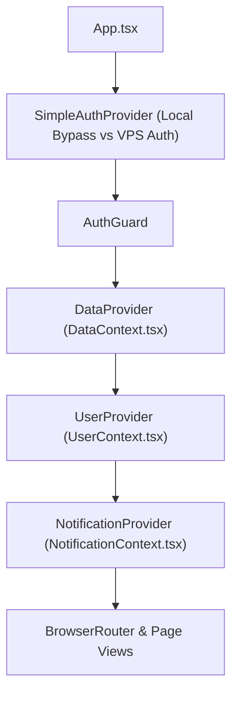

# Safaeewala Operations Dashboard — Technical Architecture & Infrastructure

> **Document Status:** Active & Standardized  
> **Last Updated:** October 2026  
> **Repository:** `Safaeewala Booking Dashboard`  
> **Core Focus:** Full-Stack Architecture, State Stores, Hybrid Sync, Authentication Isolation, Containerization, and VPS Deployment.

---

## 1. System Overview & Technology Stack

The Safaeewala Booking CRM is a high-performance, containerized single-page web application (SPA) built for commercial cleaning dispatch, recurring residential contracts, staff overtime tracking, and invoicing.

```
┌────────────────────────────────────────────────────────────────────────┐
│                        SAFAEEWALA CLIENT LAYER                         │
│  React 19 + TypeScript + Vite 8 + Tailwind CSS v4 + Lucide Icons       │
│  State Stores: DataContext · UserContext · NotificationContext         │
└─────────────────────────────────┬──────────────────────────────────────┘
                                  │
         ┌────────────────────────┴────────────────────────┐
         ▼                                                 ▼
┌──────────────────────────────┐        ┌────────────────────────────────┐
│  OFFLINE / LOCAL STORAGE     │        │  CLOUD BACKEND (SUPABASE)      │
│  - safaeewala_daily_jobs     │        │  - daily_jobs, daily_expenses  │
│  - safaeewala_bookings       │◄──────►│  - bookings, clients           │
│  - safaeewala_invoices       │        │  - employees, inventory        │
│  - Fast 2000ms Timeout Guard │        │  - profiles, audit_log         │
└──────────────────────────────┘        └────────────────────────────────┘
                                  │
                                  ▼
┌────────────────────────────────────────────────────────────────────────┐
│                        BACKEND SERVICES LAYER                          │
│  - webhookServer.cjs (Port 3001: Fluent Forms, GHL Sync, Google Drive) │
│  - Nginx Reverse Proxy (Port 80/8080)                                 │
│  - Docker Containerized Runtime on Ubuntu VPS                          │
└────────────────────────────────────────────────────────────────────────┘
```

### 1.1 Core Technologies

| Layer | Technology | Version | Purpose |
|---|---|---|---|
| **Build & Tooling** | Vite | `^8.0.13` | High-speed ESM dev server and Rolldown/Rollup bundler |
| **UI Framework** | React | `^19.2.6` | Modern concurrent component rendering and Suspense |
| **Type Safety** | TypeScript | `~5.9.3` | Strict static typing across models, props, and sync logic |
| **Styling** | Tailwind CSS | `@tailwindcss/vite ^4.3.0` | Utility-first responsive CSS and CSS variable tokens |
| **Icons** | Lucide React | `^1.16.0` | Comprehensive SVG operational iconography |
| **Spreadsheets** | SheetJS (xlsx) | `^0.18.5` | In-browser Excel parsing and customized export generator |
| **Charts** | Recharts | `^3.8.1` | Financial analytics and performance visualizations |
| **Backend & DB** | Supabase | `@supabase/supabase-js ^2.106.1` | Managed PostgreSQL, Auth, and Audit Logging |
| **Containerization**| Docker & Docker Compose | Latest | Isolated Alpine Nginx + Node runtime on VPS |

---

## 2. Directory & Module Architecture

```
e:\ANTIGRAVITY PROJECTS\Safaeewala Booking Dashboard\
├── .github/
│   └── workflows/
│       └── deploy.yml              # GitHub Actions CI/CD to VPS
├── redesign/                       # Dedicated Executive Redesign & Theme Studio
│   ├── themes.ts                   # 5 Executive Color Themes & Design Tokens
│   ├── ThemeSelector.tsx           # Interactive Live Theme Switcher Bar & Drawer
│   └── RedesignedEmployees.tsx     # High-End Employees Screen with Duty & OT
├── src/
│   ├── components/
│   │   ├── layout/
│   │   │   ├── Layout.tsx          # Shell with Sidebar, Header, and responsive backdrop
│   │   │   ├── PageHero.tsx        # Signature gradient hero banner with action buttons
│   │   │   └── Sidebar.tsx         # Workspace navigation and user session indicator
│   │   └── ui/                     # Primitives (Button, Modal, Input, Badge)
│   ├── data/
│   │   └── mock.ts                 # Seed fallbacks and dashboard stats
│   ├── lib/
│   │   ├── clientDataSync.ts       # Core OT algorithms, address cleaning, entity synthesis
│   │   ├── simpleAuth.ts           # Local development bypass & VPS session security
│   │   ├── fluentFormsSync.ts      # Webhook lead synchronization
│   │   ├── ghlService.ts           # GoHighLevel CRM bi-directional sync
│   │   ├── googleDrive.ts          # Cloud document backups
│   │   ├── storageUtils.ts         # Safe LocalStorage accessors with quota error guards
│   │   └── supabase.ts             # Supabase client instantiation
│   ├── pages/                      # Application views (Overview, Bookings, Employees, etc.)
│   ├── store/
│   │   ├── DataContext.tsx         # Master operational state store and Supabase sync
│   │   ├── UserContext.tsx         # RBAC permissions and user profile store
│   │   └── NotificationContext.tsx # System alerts and reminder notifications
│   ├── types/
│   │   └── index.ts                # Master TypeScript interfaces and types
│   ├── App.tsx                     # Top-level routing, Suspense lazy boundaries, AuthGuard
│   ├── main.tsx                    # Application entry point
│   └── index.css                   # Global styles and design tokens
├── deploy.ps1                      # Direct PowerShell VPS SSH/SCP deployment script
├── docker-compose.yml              # VPS Docker compose service definition
├── Dockerfile                      # Multi-stage production container build
├── nginx.conf                      # Nginx SPA router & webhook reverse proxy configuration
├── rules.md                        # Master Overtime, Data Mapping, and Sync Rules
├── design.md                       # Design System, Aesthetics, and Theme Studio Specs
└── architecture.md                 # System Architecture & Infrastructure (this file)
```

---

## 3. State Management & Data Flow

State is organized into 3 domain-specific React Contexts wrapped in [`src/App.tsx`](file:///e:/ANTIGRAVITY%20PROJECTS/Safaeewala%20Booking%20Dashboard/src/App.tsx):



### 3.1 DataContext (`src/store/DataContext.tsx`)
- **Managed Collections:**
  - `bookings`: Operational schedule and team assignments.
  - `clients`: Unified registered clients + auto-discovered clients from Daily Job Sheet.
  - `employees`: Unified registered staff + auto-discovered roster staff from Daily Job Sheet.
  - `invoices`: General invoices and monthly client bills.
  - `inventory`: Equipment, chemicals, and minimum stock alerts.
  - `dailyJobs`: Master transactional ledger from Excel imports / manual logs.
  - `dailyExpenses`: Shift-level petty cash and operational expenditures.
- **Dynamic Synthesizers (`useMemo`):**
  - `allClients = extractAllClientsFromDailyJobs(dailyJobs, clients)`
  - `allEmployees = extractAllEmployeesFromDailyJobs(dailyJobs, employees)`
  - Ensures changes in `dailyJobs` immediately update clients, employee rosters, and work hours everywhere in the app without manual refresh.

### 3.2 UserContext (`src/store/UserContext.tsx`)
- Enforces Role-Based Access Control (RBAC):
  - `'owner'`: Full system administrative access.
  - `'office_staff'`: Bookings, dispatch, client communication, invoices.
  - `'crew_lead'`: Daily job sheet entries, attendance, crew status.
  - `'cleaner'`: Personal duty hours and shift records.

---

## 4. Hybrid Persistence & Offline-First Sync Layer

To ensure the CRM remains instantaneous even with large Excel sheets or intermittent internet in Dubai dispatch warehouses, the app implements a **dual-layer storage strategy**:

### 4.1 Fast Timeout Guard (2000ms Race Condition Protector)
When the application boots in [`src/store/DataContext.tsx`](file:///e:/ANTIGRAVITY%20PROJECTS/Safaeewala%20Booking%20Dashboard/src/store/DataContext.tsx#L141-L152):
```ts
const timeoutPromise = new Promise<any[]>((_, reject) =>
  setTimeout(() => reject(new Error('timeout')), 2000)
)
const fetchPromise = supabase.from(table).select('*').order(order, { ascending: false }).then(r => r.data ?? [])
const data = await Promise.race([fetchPromise, timeoutPromise])
```
- If Supabase responds within 2000ms, the cloud data hydrates the state.
- If the network is slow or offline, the timeout fires immediately and the app loads cached data from `localStorage`.
- **Result:** Zero frozen screens or infinite spinners.

### 4.2 Auto-Persistence
Every mutation to `dailyJobs`, `bookings`, `invoices`, `inventory`, or `dailyExpenses` triggers an automated `safeLocalStorageSet` to disk with JSON serialization and storage quota validation.

---

## 5. Authentication & Environment Isolation Architecture

Authentication is managed via [`src/lib/simpleAuth.ts`](file:///e:/ANTIGRAVITY%20PROJECTS/Safaeewala%20Booking%20Dashboard/src/lib/simpleAuth.ts):

### 5.1 Local Development Mode (`isLocalEnvironment()`)
```ts
export function isLocalEnvironment(): boolean {
  if (typeof window === 'undefined') return false
  const host = window.location.hostname
  return (
    Boolean(import.meta.env.DEV) ||
    host === 'localhost' ||
    host === '127.0.0.1' ||
    host === '::1' ||
    host.endsWith('.local')
  )
}
```
- When running on `localhost:5058` or dev mode:
  - `AuthGuard` skips login.
  - Session is initialized with permanent authenticated admin access.
  - Zero login friction during local development and testing.

### 5.2 VPS Production Mode
- When served from the VPS IP (`187.77.116.14`) or custom production domain:
  - `isLocalEnvironment()` evaluates to `false`.
  - `AuthGuard` intercepts unauthenticated visitors and renders [`Login.tsx`](file:///e:/ANTIGRAVITY%20PROJECTS/Safaeewala%20Booking%20Dashboard/src/pages/Login.tsx).
  - Rate limiting active: 5 failed attempts locks login for 60 seconds.
  - Authenticated session stored with 7-day TTL.

---

## 6. Backend Services & Webhook Server

Located in [`webhookServer.cjs`](file:///e:/ANTIGRAVITY%20PROJECTS/Safaeewala%20Booking%20Dashboard/webhookServer.cjs):
- **Port:** `3001` (internal Docker network, proxied by Nginx under `/api/`).
- **Endpoints:**
  - `POST /api/fluent-forms/webhook`: Ingests inbound lead forms from the Safaeewala WordPress site.
  - `POST /api/ghl/sync`: Two-way contact and pipeline stage synchronization with GoHighLevel.
  - `POST /api/google-drive/upload`: Backs up contracts, Emirates ID scans, and exported Excel files.
  - `GET /health`: Healthcheck endpoint for Docker container status.

---

## 7. Containerization & VPS DevOps Architecture

### 7.1 Container Specification (`Dockerfile`)
- **Base:** `nginx:alpine`
- **Runtime Addition:** `nodejs` added to Alpine image to run `webhookServer.cjs` alongside Nginx.
- **Entrypoint:** [`entrypoint.sh`](file:///e:/ANTIGRAVITY%20PROJECTS/Safaeewala%20Booking%20Dashboard/entrypoint.sh) boots both the Node webhook daemon in the background and Nginx in the foreground.
- **Port Mapping:**
  - Internal: `80` (Nginx), `3001` (Webhooks).
  - External Host: `0.0.0.0:8080 -> 80/tcp`.

### 7.2 Deployment Pipelines

#### Pipeline A: Direct PowerShell Deployment (`deploy.ps1`)
Used for immediate local-to-VPS deployment:
1. `npm run build`: Generates optimized client bundle in `dist/`.
2. Sync via SCP over SSH (`id_rsa` key): Transmits `dist`, `Dockerfile`, `nginx.conf`, `docker-compose.yml`, `webhookServer.cjs`, and `entrypoint.sh` to `/var/www/safaeewala/`.
3. Remote Docker rebuild via SSH:
   `docker compose up -d --build && docker ps --filter name=safaeewala-booking-crm`
4. Container restarts seamlessly with zero downtime for existing data volumes (`/var/www/safaeewala/data`).

#### Pipeline B: GitHub Actions CI/CD (`.github/workflows/deploy.yml`)
Triggered automatically on `git push origin main`:
- GitHub hosted Ubuntu runner installs dependencies and builds production assets.
- Deploys `dist/` directly to VPS via encrypted SSH secret keys.
