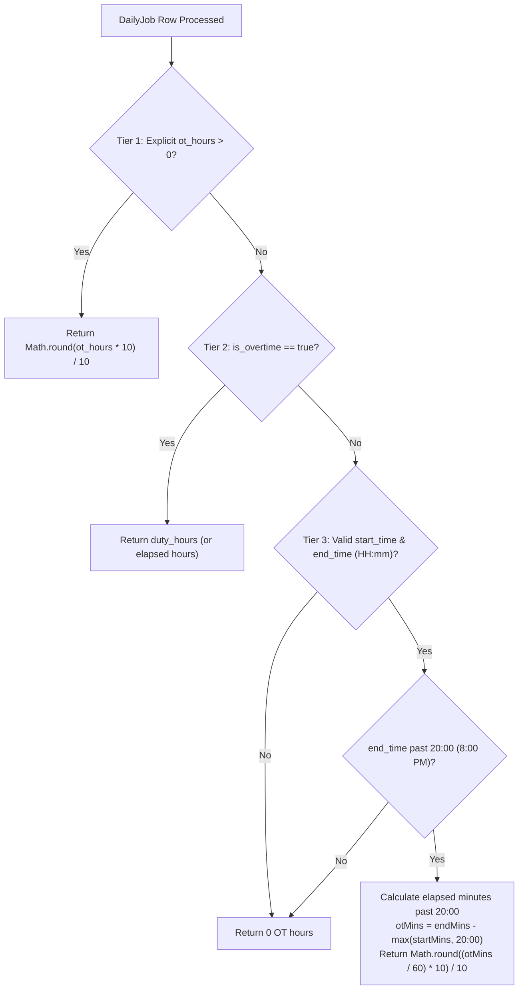

# Safaeewala Operations Dashboard — System Rules & Data Sync Logic

> **Document Status:** Active & Standardized  
> **Last Updated:** October 2026  
> **Repository:** `Safaeewala Booking Dashboard`  
> **Core Focus:** Overtime (OT) Calculations, Data Normalization, Synthetic Entity Synthesis, and Screen-by-Screen Data Synchronization.

---

## 1. Executive Summary & Core Philosophy

The Safaeewala Booking CRM operates on a **hybrid real-time & operational ledger model**. In commercial cleaning and maid operations in Dubai/UAE:
1. Operational reality moves faster than rigid schemas: daily assignments, last-minute shift adjustments, cash-on-delivery payments, and overtime are recorded directly in the **Daily Job Sheet**.
2. Registered databases (Supabase tables for Clients and Employees) exist alongside transactional rosters.
3. The system enforces **automatic bidirectional synthesis**: transaction records from Excel or manual daily job logs automatically extract, deduplicate, and enrich client profiles, employee work logs, overtime metrics, and recurring billing.

---

## 2. Overtime (OT) Calculation Rules & Algorithms

Overtime is one of the most critical labor and financial metrics for cleaning staff management. The system uses a strict **3-tier hierarchical calculation algorithm** defined in [`calcJobOTHours`](file:///e:/ANTIGRAVITY%20PROJECTS/Safaeewala%20Booking%20Dashboard/src/lib/clientDataSync.ts#L75-L97).

### 2.1 The 3-Tier Overtime Determination Algorithm



#### Tier 1: Explicit Overtime Hours
- If `job.ot_hours` is present and greater than `0`, this value is treated as the ground truth.
- Formula:
  $$\text{OT} = \text{round}((\text{job.ot\_hours}) \times 10) / 10$$

#### Tier 2: Explicit Overtime Shift Flag (`is_overtime`)
- If `job.is_overtime` is marked `true` (e.g. weekend shift, holiday emergency deep clean, or night shift), the entire shift is recognized as overtime.
- Formula:
  $$\text{OT} = \text{job.duty\_hours}$$

#### Tier 3: Automatic Time Cutoff (Evening Hours past 20:00)
- In the UAE domestic cleaning industry, standard day shifts conclude by 20:00 (8:00 PM).
- Any job extending past `20:00` (1200 minutes from midnight) automatically logs overtime for the duration worked after 8:00 PM.
- Calculation:
  $$\text{endMins} = \text{endHour} \times 60 + \text{endMinute}$$
  $$\text{otStartMins} = \max(\text{startMins}, 1200)$$
  $$\text{otMins} = \text{endMins} - \text{otStartMins}$$
  $$\text{OT} = \max(0, \text{round}((\text{otMins} / 60) \times 10) / 10)$$

---

### 2.2 Overtime Aggregations & Performance Thresholds

1. **Total Logged Time per Employee:**
   $$\text{Total Workload (hrs)} = \text{Duty Hours} + \text{OT Hours}$$
2. **Overtime Ratio (% of Worked Time):**
   $$\text{OT Ratio} = \text{round}\left(\frac{\text{OT Hours}}{\text{Total Workload}} \times 100\right)\%$$
3. **High Overtime (High OT) Threshold:**
   - Any cleaner clocking **$\ge 10.0$ hours of OT** within the active date period is automatically flagged with:
     - Prominent Amber/Orange accent stripe on their employee card.
     - `HIGH` indicator badge on their work card.
     - Inclusion in the `⚡ High OT >10h` quick filter view.
4. **Estimated Overtime Pay Multiplier:**
   - Base pay rate: `emp.pay_rate_hourly` (Standard default: `AED 14.00/hr`).
   - Overtime pay rate standard: `AED 17.50/hr` (1.25x base) or `AED 21.00/hr` (1.5x base for holiday/night).
   - Estimated Overtime Cost formula:
     $$\text{Estimated OT Cost} = \text{OT Hours} \times 17.5\,\text{AED}$$

---

## 3. Data Mapping & Normalization Logic

When importing daily jobs from Excel or external spreadsheets, raw data often contains non-standard formatting, billing remarks in address fields, and Excel summary footers. The system applies strict normalization layers before any data is aggregated.

### 3.1 String Normalization
- Functions: `normalizeKey(text)` and `normalizeStaffName(name)`.
- Strip all non-alphanumeric characters, convert to lowercase, and trim leading/trailing whitespace:
  $$\text{normalized} = \text{text.toLowerCase().replace(/[^a-z0-9]/g, '').trim()}$$

### 3.2 Address Cleaning & Client Name Extraction
Raw spreadsheet addresses frequently contain inline payment or monthly tags, such as:
- `Flat 309 Bldg 31 A(Feb Monthly)` $\rightarrow$ `Flat 309 Bldg 31 A`
- `807 Nilofer(Monthly) - Cash` $\rightarrow$ `807 Nilofer`
- `Villa 14, Springs 2 (Pending)` $\rightarrow$ `Villa 14, Springs 2`

**Regex Sanitization Sequence in [`cleanClientNameFromAddress`](file:///e:/ANTIGRAVITY%20PROJECTS/Safaeewala%20Booking%20Dashboard/src/lib/clientDataSync.ts#L16-L29):**
1. Remove `\s*\([^)]*monthly[^)]*\)` (case-insensitive)
2. Remove `\s*\([^)]*cash[^)]*\)`
3. Remove `\s*\([^)]*pending[^)]*\)`
4. Remove `\s*\([^)]*online[^)]*\)`
5. Remove `\s*\([^)]*above[^)]*\)`
6. Strip trailing/leading punctuation: `^[-–—,:\s]+|[-–—,:\s]+$`

### 3.3 Deterministic Entity ID Generation

| Entity | ID Format | Example |
|---|---|---|
| **Synthesized Client** | `dj-${normalizedCleanAddress}` | `dj-flat309bldg31a` |
| **Synthesized Staff** | `emp-dj-${normalizedStaffName}` | `emp-dj-laxmirani` |
| **Direct Booking Client** | UUIDv4 | `e9b8f23a-4f51-4122-...` |

### 3.4 Bogus Row Detection (`isBogusJob`)
To prevent Excel summary rows from polluting operational metrics, a job is filtered out if:
- Both `address` and `times` are empty / placeholder dashes (`—`, `-`).
- `address` is empty AND (`charges > 1500` OR `received > 1500`) $\rightarrow$ denotes a footer total.
- `duty_hours > 24` $\rightarrow$ impossible single-shift duration.
- Combined text across fields matches reserved summary keywords:
  `['gross', 'pending rcvd', 'total', 'expences', 'net total', 'summary', 'expense']`.

---

## 4. Screen-by-Screen Data Synchronization Rules

### 4.1 Daily Job Sheet (`/daily-job-sheet`)
*The primary operational ledger of the company.*
- **Data Ingestion:** Excel files (.xlsx, .xls) parsed with date cell conversions and strict type coercion (`safeNum`).
- **Persistence:** LocalStorage key `safaeewala_daily_jobs` + Supabase table `daily_jobs`.
- **Cash & Revenue Rules:**
  - `charges`: Total invoiceable fee for the visit.
  - `received`: Amount collected on site by the cleaner (Cash / Instant Online).
  - `payment_mode`: `'Cash' | 'Online' | 'Pending' | 'Monthly' | 'Above'`.
  - Cash collected on site directly feeds into the cashier's daily cash register.
- **Expenses Extraction:** Rows with category markers or remarks containing expense descriptions automatically map to `safaeewala_daily_expenses`.

---

### 4.2 Employees & Staff Roster (`/employees` & `/redesign/employees`)
*Workforce management, duty hours, overtime tracking, and compliance.*
- **Auto-Discovery Rule (`extractAllEmployeesFromDailyJobs`):**
  - All staff names appearing on the Daily Job Sheet are normalized.
  - If a staff member does not exist in registered employees, a synthetic employee profile (`emp-dj-${normName}`) is automatically instantiated.
  - Known roster names (e.g., Sharmila, Sharada, Laxmi Rani, Parmila, Sita, Krishna, Ibrahim, etc.) are pre-seeded to guarantee complete roster visibility.
- **Duty & Overtime Aggregation (`staffJobStats`):**
  - Jobs are filtered by active date range (`activeDateRange`: All Time, Today, Yesterday, 7 Days, 30 Days, 3 Months, 6 Months, Custom).
  - Regular Duty Hours: $\sum \text{job.duty\_hours}$.
  - Overtime Hours: $\sum \text{calcJobOTHours(job)}$.
  - Total Shifts: Count of valid completed jobs in the period.
- **Live Duty Status Resolution:**
  1. `emp.status === 'on_leave'` $\rightarrow$ **On Leave**.
  2. `emp.status === 'inactive'` $\rightarrow$ **Inactive**.
  3. `todayJob` exists in Daily Job Sheet $\rightarrow$ **On Duty Today** (with location & time, e.g. `Marina Gate (08:00 - 16:00)`).
  4. Active booking exists for today in Supabase bookings $\rightarrow$ **On Live Job** / **Scheduled**.
  5. Otherwise $\rightarrow$ **Available / Standby**.
- **Excel Roster Export:**
  - Generates `.xlsx` including Employee ID, Full Name, Role, Duty Hours, OT Hours, Total Hours, Shifts Count, Pay Rate, Visa Expiry, and Status.

---

### 4.3 Monthly Clients (`/monthly-clients`)
*Recurring subscription contracts and residential maintenance clients.*
- **Monthly Job Qualification (`isMonthlyJob`):**
  - `payment_mode.toLowerCase() === 'monthly'` OR
  - `job.remarks` contains `'monthly'` OR
  - `job.address` contains `'monthly'`.
- **Client Aggregation (`extractMonthlyClientsFromDailyJobs`):**
  - Groups monthly jobs by cleaned normalized client address.
  - Calculates:
    - `totalCharges`: Sum of all monthly job charges in period.
    - `totalReceived`: Cash and online payments collected.
    - `balanceDue`: $\max(0, \text{totalCharges} - \text{totalReceived})$.
    - `visitsCount`: Total cleaning visits completed for the contract.
- **Schedule Isolation Rule (Temporary Daily Changes vs. Permanent Contract Schedule):**
  - **Core Rule:** *Monthly Clients kay schedule mein Daily Job Sheet par ki janay wali koi bhi tabdeeli — jaisay time, date, cleaner assignment, ya duration — temporary (aarzi) samjhi jaye gi aur woh Monthly Client kay asal permanent master schedule ko kabhi update nahi karay gi.*
  - **Daily Job Sheet Scope:** Edits made in `/daily-job-sheet` (e.g. changing start time from 09:00 to 10:00, or reassigning cleaner for a specific date) are strictly isolated to that specific date's `DailyJob` row.
  - **Permanent Master Schedule Protection:** The client's recurring contract template (`service_days`, `scheduled_time`, `end_time`, `duration_hours`, `preferred_cleaner`, and `day_cleaner_assignments`) remains permanent, immutable, and protected from daily sheet edits.
  - **Where Permanent Changes Happen:** Permanent contract modifications can ONLY be made inside the Monthly Clients screen (`/monthly-clients`) or Client Profile modal.

---

### 4.3.1 Attendance System & Cleaner Classification (`/attendance`)
*Workforce availability, shift synchronization, and live attendance tracking.*
- **Daily Job Sheet Live Synchronization:**
  - Attendance is calculated in real time by scanning `dailyJobs` for the selected date.
- **Attendance Classification Rule (Haaziri Ka Usool):**
  1. **Present (Working):** Cleaners who have 1 or more active cleaning shifts logged on the selected date. System aggregates duty hours and overtime.
  2. **Available (Standby / No Job Assigned):** Cleaners with blank/nil entries (0 jobs assigned on that date) are **strictly classified as Available / Standby** for deployment. **They are NOT counted as absent**.
  3. **Specifically Absent / On Leave:** A cleaner is ONLY counted as absent if specifically marked with an explicit reason (e.g., remarks/notes containing "Absent", "Sick", "Leave", "Emergency", or manual override).
- **Daily Sheet Row Styling:** Nil/blank cleaner rows in the Daily Job Sheet reflect calm sky-blue `"Available (No jobs assigned)"` / `"Standby"` badges rather than red absent flags.

---

### 4.4 Bookings & Dispatch (`/bookings`)
*Scheduled appointments, one-off deep cleans, and team dispatch.*
- **Status Lifecycle:**
  $$\text{pending} \longrightarrow \text{confirmed} \longrightarrow \text{in\_progress} \longrightarrow \text{completed} \quad (\text{or } \text{cancelled})$$
- **Automatic Client Linkage:**
  - When a booking is created, client name is matched against existing clients.
  - If no match exists, a new Client record is deterministically created with address, city (Dubai), and phone number.
- **Live Dispatch Integration:**
  - `assigned_crew` stores employee IDs.
  - Any booking on today's date in `in_progress` or `confirmed` status feeds directly into the live crew status widgets on the dashboard and employees screens.

---

### 4.5 Clients Directory (`/clients` & `/clients/:id`)
*Customer relationships, property details, and visit histories.*
- **Unified Client Synthesis (`extractAllClientsFromDailyJobs`):**
  - Merges Supabase registered clients with auto-discovered clients from the Daily Job Sheet.
  - Links total historical spend, total booking count, and last service date across all modules.

---

### 4.6 Invoices & Billing (`/invoices` & `/monthly-invoices`)
*VAT-compliant financial invoicing in the UAE.*
- **TRN Compliance:**
  - Invoices automatically populate company Tax Registration Number (TRN): `100234567890003` (or custom setting from `company_settings`).
- **VAT Calculation:**
  $$\text{VAT Amount} = \text{round}((\text{subtotal} \times 0.05) \times 100) / 100$$
  $$\text{Total Invoice Amount} = \text{subtotal} + \text{VAT Amount}$$
- **Status Flow:** `'draft' | 'sent' | 'paid' | 'overdue'`.

---

### 4.7 Expenses (`/expenses`)
*Operational expenditures and petty cash management.*
- Categorization: Equipment, Chemicals & Cleaning Supplies, Staff Transport & Fuel, Visa & Labor Renewals, Food & Accommodation, Marketing, Petty Cash.
- Sources: Direct Expenses recorded in app + Daily petty cash recorded on the job sheet.

---

### 4.8 Pending Payments (`/pending`)
*Receivables tracking and cash collection auditing.*
- Tracks outstanding balances across daily jobs (`payment_mode === 'Pending'`) and unpaid invoices (`status === 'sent' | 'overdue'`).
- Reconciles cash handed over by crew leads at the end of daily shifts.

---

### 4.9 Fluent Forms Leads (`/fluent-forms`)
*Inbound lead automation from WordPress website forms.*
- Ingested via local/cloud webhook endpoint `/api/fluent-forms/webhook`.
- Status pipeline: `'new' | 'contacted' | 'quoted' | 'converted' | 'lost'`.
- 1-Click Conversion: Converts any qualified lead directly into a confirmed Booking and registered Client profile with all pre-filled contact details.

---

## 5. Security & Deployment Isolation Rules

### 5.1 Local vs. VPS Authentication Rules
- **Rule Definition in [`isLocalEnvironment`](file:///e:/ANTIGRAVITY%20PROJECTS/Safaeewala%20Booking%20Dashboard/src/lib/simpleAuth.ts#L27-L38):**
  ```ts
  export function isLocalEnvironment(): boolean {
    if (typeof window === 'undefined') return false
    const host = window.location.hostname
    return (
      Boolean(import.meta.env.DEV) ||
      host === 'localhost' ||
      host === '127.0.0.1' ||
      host === '::1' ||
      host.endsWith('.local')
    )
  }
  ```
- **Local Development (`localhost:5058`):**
  - **Password Bypass:** `AuthGuard` skips login prompts and automatically signs in as `admin`.
  - Enables frictionless local iteration, UI testing, and offline work.
- **VPS Production Server (`187.77.116.14:8080`):**
  - **Strict Authentication Enforced:** `AuthGuard` requires valid administrator credentials.
  - Rate limiting active: 5 failed attempts locks login for 60 seconds.
  - Session TTL: 7 days with persistent storage sync.
